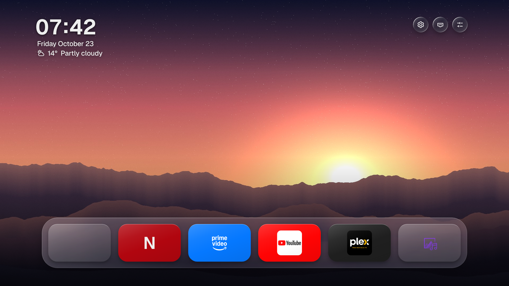
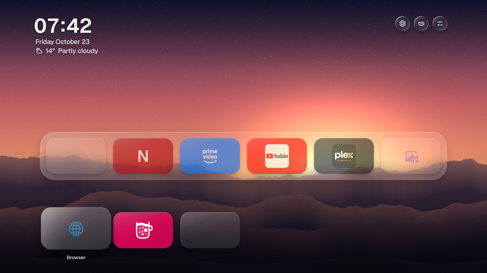
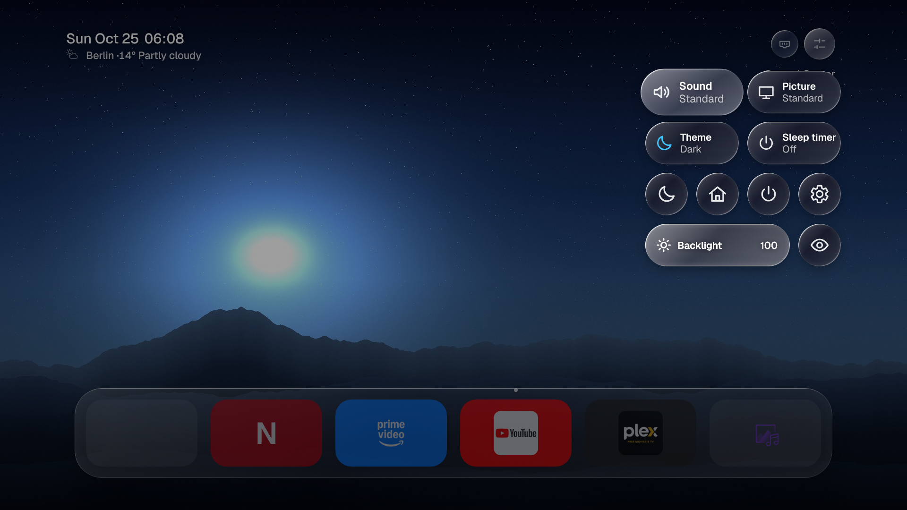
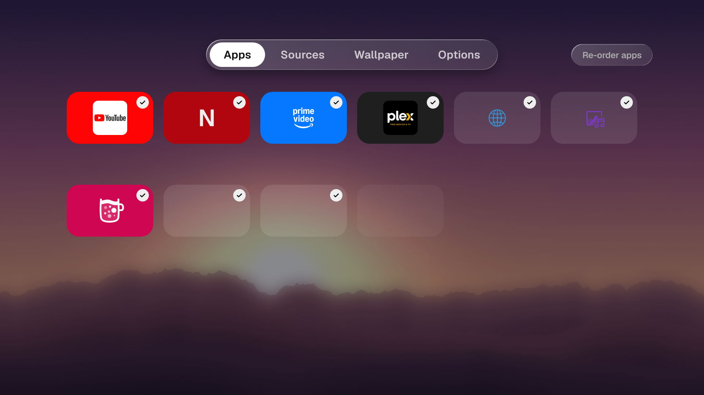
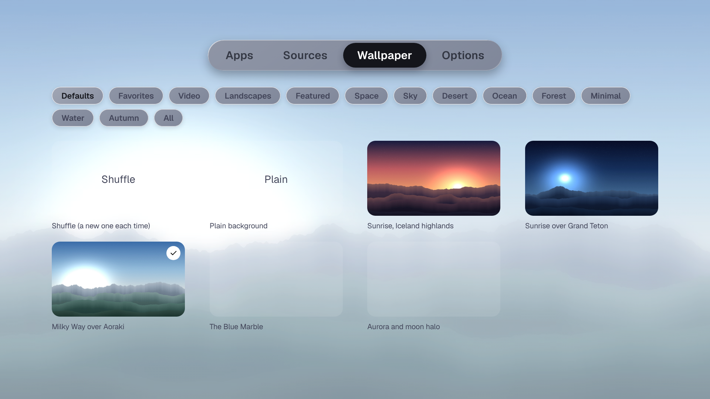
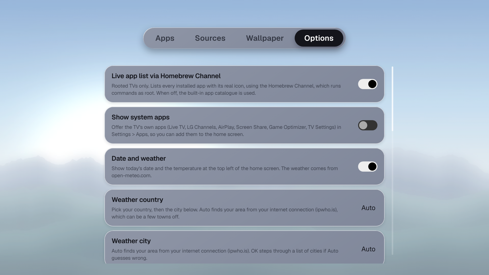
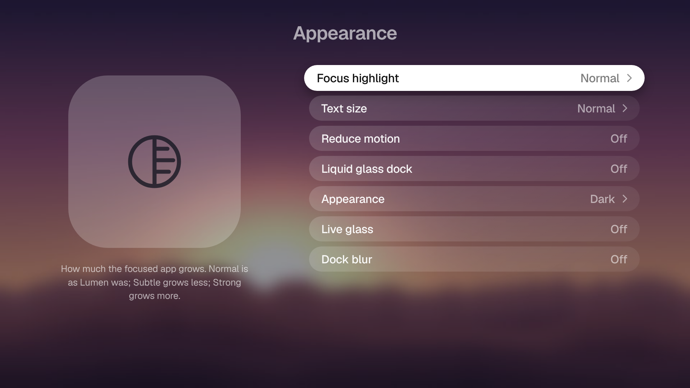

# Lumen Fork

A fork of https://github.com/ammar027/lumen-webos with the following changes:

- slowdown when sliding to the second row of the dock is fixed
- you can now search for a location that will be used in the weather widget
- alternative control center layout with toggle in settings
- bigger time and weather widget with toggle in settings

## Compatibility

Tested on a rooted LG C3 77" with Webos 9. Compatibility on other models, earlier or later Webos versions is not guaranteed. 

## Installation

Install the .ipk available in the Releases section.
This fork is standalone. Installing the original Lumen beforehand is not necessary.

## How to make your TV boot into Lumen

The command you have to send via Terminal (webos dev manager can do that) is

`luna-send-pub -n 1 'luna://com.webos.service.eim/addDevice' '{"appId":"com.ammar027.lumen","pigImage":"","mvpdIcon":""}'`

This will add Lumen as a selectable input in LG's home menu. If you set your TV to go straight to last input after switching it on, it'll go directly into the launcher when turning it on. Nothing can be broken by this. It will not replace the default launcher, it will just add homebrew as an input.

If you additionally want to map the launcher to the home button on your remote, use lginputhook and map your home button to `com.ammar027.lumen`.

## Screenshots

